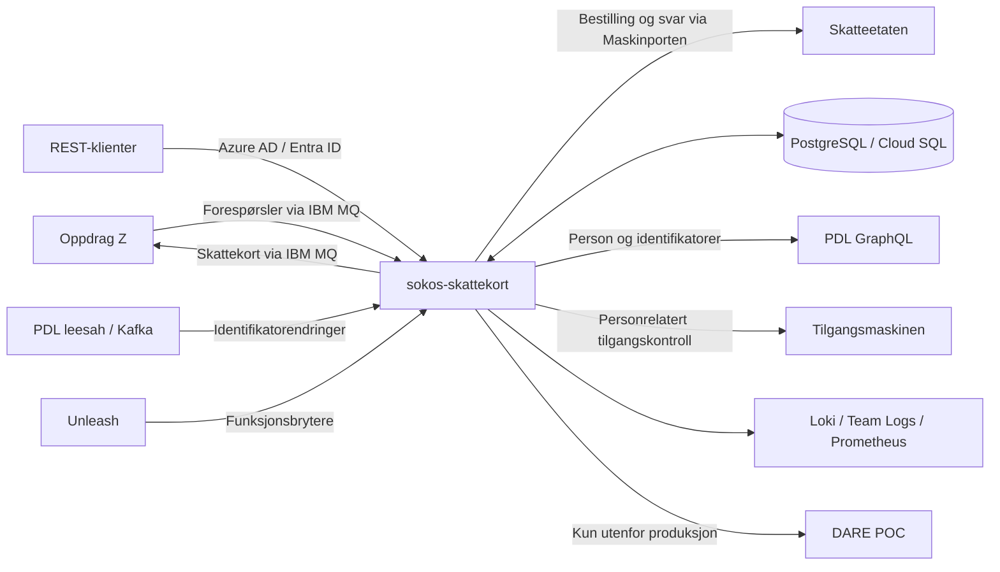

# Arkitektur og grensesnitt

## Oversikt

Applikasjonen er en Kotlin/Ktor-tjeneste på Nais i GCP. PostgreSQL i Cloud SQL lagrer både fagdata og
db-scheduler sin kjøretilstand. IBM MQ forbinder tjenesten med Oppdrag Z.

## Komponenter og oppstart

[Application](../../src/main/kotlin/no/nav/sokos/skattekort/Application.kt) laster konfigurasjon og kjører
Flyway før tjenester og ruter kobles opp.
[ApplicationServices](../../src/main/kotlin/no/nav/sokos/skattekort/config/ApplicationServices.kt) oppretter og
kobler tjenestene og infrastrukturklientene manuelt.
[RoutingConfig](../../src/main/kotlin/no/nav/sokos/skattekort/config/RoutingConfig.kt) mottar denne samlingen;
hver API-rutefunksjon får bare tjenestene den bruker.

Bakgrunnsbehandlingen består av MQ-lytter, Kafka-konsument, databasebaserte periodiske jobber og
bakgrunnsoppgaver for bulkbestilling. Se [prosessbeskrivelsen](workflows.md).
Readiness og liveness viser applikasjonens livssyklus, ikke at alle eksterne avhengigheter fungerer.

## Avhengigheter

| Avhengighet | Bruk | Betydning ved avbrudd |
|-------------|------|----------------------|
| PostgreSQL | Personer, abonnementer, bestillinger, skattekort, utsendinger og scheduler | Behandling og oppstart med migrering krever database |
| IBM MQ | Forespørsler og leveranse til Oppdrag Z | Mottak eller levering stopper; køer og feiltellere må følges opp |
| Skatteetatens API | Bestille skattekort, hente svar og etterspørre oppdateringer | Nye og oppdaterte skattekort blir forsinket; lagrede kort kan fortsatt være tilgjengelige |
| Maskinporten | Token med systembruker for Skatteetaten | Bestilling og henting fra Skatteetaten kan ikke fullføres |
| PDL og Kafka | Personoppslag og oppfølging av identifikatorendringer | Personavklaring og ajourhold kan bli forsinket |
| Azure AD / Entra ID | Tokenvalidering og tokens til interne API-er | Beskyttede kall kan feile |
| Tilgangsmaskinen | Tilgangsvurdering for personrelaterte brukerkall | Berørte oppslag kan ikke fullføres som normalt |
| Unleash | Oppstart og styring av behandlingstrinn | Tilgang og riktige brytere må verifiseres ved oppstart og driftsavvik |

Nettverkstilganger og klienttillatelser er deklarert i [Nais-manifestene](../../.nais).
Miljøspesifikke endepunkter og køer er definert i [application-profilene](../../src/main/resources).

## MQ-kontrakter

Innkommende tekstmeldinger er semikolonseparert: `forsystem;inntektsaar;identifikator[;identifikator...]`.
`OS` med flere identifikatorer behandles som `OS_STOR`.
XML-format støttes ikke av mottaket. Parseren ligger i
[ForespoerselService](../../src/main/kotlin/no/nav/sokos/skattekort/forespoersel/ForespoerselService.kt).

Utgående meldinger til Oppdrag Z bruker fastposisjonsformat fra
[SkattekortFixedRecordFormatter](../../src/main/kotlin/no/nav/sokos/skattekort/utsending/oppdragz/SkattekortFixedRecordFormatter.kt).
De to leveransekøene skiller ordinære og store bestillinger. Oppdateringer for `OS_STOR` rutes til ordinær OS-kø.
Feil ved mottaksbehandling som kaster unntak sendes til inngangskøens navn med suffiks `_BOQ`.

| Miljø | Inngangskø | Ordinær leveranse | Stor leveranse |
|-------|------------|------------------|----------------|
| Q2 | `QA.Q2_SKATTEKORT.FRA_FORSYSTEM` | `QA.Q2_231.OB04_SKATTEKORT` | `QA.Q2_231.OB04_SKATTEKORT_STOR` |
| Q1 | `QA.Q1_SKATTEKORT.FRA_FORSYSTEM` | `QA.Q1_231.OB04_SKATTEKORT` | `QA.Q1_231.OB04_SKATTEKORT_STOR` |
| Produksjon | `QA.P_SKATTEKORT.FRA_FORSYSTEM` | `QA.P231.OB04_SKATTEKORT` | `QA.P231.OB04_SKATTEKORT_STOR` |

MQ-kontrakten har ikke et versjonsnummer i kønavnet. Formatendringer må avklares med Oppdrag Z.
Se [resultathåndtering](returer.md) for tilfeller der et lagret skattekort ikke gir en utgående melding.

## REST-API-er

| API | Formål | OpenAPI |
|-----|--------|---------|
| `/api/v1/skattekort` | Enkelt- og bulkbestilling, status og statuser | [Bestilling/status](../../src/main/resources/openapi/skattekort-v1-swagger.yaml) |
| `/api/v1/person` | Oppslag og manuell opprettelse av skattekort | [Person v1](../../src/main/resources/openapi/sokos-skattekort-person-v1-swagger.yaml) |
| `/api/v2/person` | Oppslag, navn og manuell opprettelse; oppslag bruker en svarstruktur med `data` og `errorMessage` | [Person v2](../../src/main/resources/openapi/sokos-skattekort-person-v2-swagger.yaml) |
| `/api/v1/admin` | Batcher, bestillinger, utsendinger, nøkkelinformasjon, personhistorikk og nytt batchforsøk | [Admin](../../src/main/resources/openapi/sokos-skattekort-admin-v1-swagger.yaml) |

Swagger UI finnes på hver API-bane med `/docs`, for eksempel
[bestilling i Q2](https://sokos-skattekort.intern.dev.nav.no/api/v1/skattekort/docs)
og [lokalt](http://localhost:8080/api/v1/skattekort/docs).
Se [miljøoversikten](../drift/main.md#miljøer) for øvrige verter.

Bestilling er asynkron. `POST /api/v1/skattekort/bestille` svarer `201 Created` etter mottaksbehandlingen.
`POST /api/v1/skattekort/bestillingbulk/{forsystem}/{inntektsaar}` mottar tekst med én identifikator per linje
og svarer `202 Accepted` før bakgrunnsbehandlingen. Status og logger må brukes til å følge opp resultatet.

## Tilgangskontroll

Fagruter er beskyttet av Azure AD/Entra ID. Rutene kontrollerer scopes for brukerkall (OBO) og,
der støttet, roller for maskinkall (M2M). Kravene er definert i
[AccessPolicy](../../src/main/kotlin/no/nav/sokos/skattekort/security/AccessPolicy.kt) og de enkelte API-rutene.
Status krever `status-scope`, administrasjon og bulkbestilling krever `admin-scope`.

Et gyldig token gir ikke i seg selv rett til alle personopplysninger.
Reelle skattekort krever saksbehandlerkontekst. Personrelaterte brukerkall kan i tillegg kontrolleres mot
Tilgangsmaskinen og auditlogges. Tillatte klienter og tildelte scopes/roller varierer mellom miljøene.
Ikke anta at en M2M-rolle eller en tillatelse fra testmiljøet finnes i produksjon.

Utgående kall til Skatteetaten bruker Maskinporten med
`skatteetaten:skattekorttilarbeidsgiver` og systembrukerclaim.
Systembruker og bestillingsorganisasjon må være konsistente. Se [konfigurasjon](../drift/konfigurasjon.md).

## Interne driftsendepunkter

`/internal/isAlive`, `/internal/isReady` og `/internal/metrics` er uten fagrutenes autentisering og brukes av Nais.
Ikke bruk disse alene som bekreftelse på at en bestilling er fullført.

## Endringer i kontrakter

Avklar funksjonelle endringer med berørte konsumenter via
[#utbetaling](https://nav-it.slack.com/archives/CKZADNFBP).
Prosjektkanalene er `#utbetaling-sokos-skattekort` for drift/utvikling og
`#utbetaling-sokos-skattekort-announcements` for versjonsvarsler.
Oppdater OpenAPI, relevante tester og dokumentasjon sammen med endringen.
Koordiner MQ-formatendringer før produksjonssetting.
