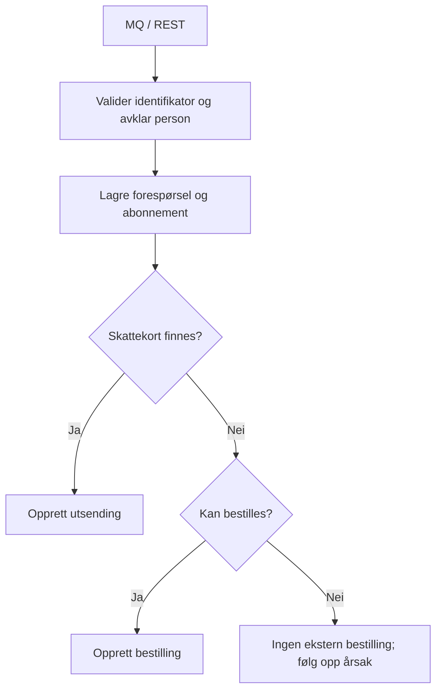

# Funksjonelle prosesser

## 1. Motta forespørsel

[ForespoerselService](../../src/main/kotlin/no/nav/sokos/skattekort/forespoersel/ForespoerselService.kt)
behandler forespørsler fra MQ og REST. Tjenesten validerer identifikatorer for miljøet, avklarer personer via PDL
og lagrer forespørsel og abonnementer. Har personen allerede skattekort for året, opprettes utsending.
Ellers opprettes bestilling hvis identifikatoren og inntektsåret tillater innhenting fra Skatteetaten.

Fra 15. desember kan ordinære forespørsler for inneværende år også behandles for neste år.
`OS_STOR` er unntatt denne utvidelsen.

## 2. Bestille, hente og behandle skattekort

Jobben `sendBestilling` utfører følgende trinn i denne rekkefølgen:

1. [BestillingService](../../src/main/kotlin/no/nav/sokos/skattekort/skattekorthenting/BestillingService.kt)
   henter svar på uferdige batcher av type `BESTILLING`.
2. [SkattekortDataService](../../src/main/kotlin/no/nav/sokos/skattekort/skattekortdata/SkattekortDataService.kt)
   behandler ubehandlede mottatte data, lagrer skattekort og eventuelle syntetiserte kort og oppretter utsendinger.
3. [BestillingsbatchService](../../src/main/kotlin/no/nav/sokos/skattekort/skattekortbestilling/BestillingsbatchService.kt)
   samler ventende bestillinger, sender til Skatteetaten og lagrer referansen i en ny batch.

Skatteetatens HTTP 204 og 503 ved henting tolkes som at svaret ikke er klart. Batchen blir liggende til senere kjøring.
`NY` og `RETRY` behandles automatisk; `FEILET` krever vurdering før nytt forsøk.
Se [feilsituasjoner](../drift/feil.md).

## 3. Bestille og hente oppdateringer

Jobben `hentOppdaterteSkattekort` henter først svar på batcher av type `OPPDATERING`, deretter bestiller den nye
oppdateringer hvis ingen slike batcher har status `NY` eller `RETRY`.
Oppdateringene gjelder inneværende og eventuelt neste år etter årsreglene.

Mottatte oppdateringsdata behandles av `SkattekortDataService` i `sendBestilling`.
Det opprettes utsendinger til abonnenter. Oppdateringer for `OS_STOR` sendes til ordinær OS-kø.
Status `INGEN_ENDRINGER` avslutter batchen uten nye skattekort.

## 4. Sende til forsystem

[UtsendingService](../../src/main/kotlin/no/nav/sokos/skattekort/utsending/UtsendingService.kt) leser utsendinger
med `fail_count < 3` og bruker det konkrete `skattekort_id` som er lagret på utsendingen.

| Forsystem | Behandling |
|-----------|------------|
| `OS` | Formater og send til ordinær MQ-kø |
| `OS_STOR` | Formater og send til stor MQ-kø |
| `MANUELL` | Fjern utsendingen uten ekstern leveranse |
| `DARE_POC` | Send via REST i ikke-produksjonsmiljø |

Ved vellykket behandling slettes utsendingene. Kort uten representerbart MQ-innhold blir ikke sendt;
årsaken registreres i personhistorikken og utsendingen fjernes.
Ved feil økes `fail_count`. Utsendinger med minst tre feil tas ikke med i automatisk behandling.
MQ og PostgreSQL har ikke en felles transaksjon; ved avbrudd må mulig dobbeltleveranse vurderes før rekjøring.

## 5. Identifikatorendringer

Kafka-konsumenten leser PDL-hendelser fra `pdl.leesah-v1` og lar
[IdentifikatorEndringService](../../src/main/kotlin/no/nav/sokos/skattekort/person/kafka/IdentifikatorEndringService.kt)
behandle identifikatorendringer. Dette holder koblingen mellom person og identifikatorer ajour.
Konsumenten er slått av i lokal profil. Ved feil logger den avviket, melder seg av og forsøker igjen etter 60 sekunder.

## 6. Historikk og sletting

Skattekort lagres som nye versjoner i stedet for å overskrive eksisterende kort.
Jobben `deleteSkattekort` sletter som standard skattekort for inneværende år minus to.
Den er implementert og kjører årlig 15. januar etter standardkonfigurasjonen.
Se [datamodell og sletting](../database/main.md) for avgrensningen og kaskadesletting.

## Kjøreplan

Planen kommer fra [JobTaskConfig](../../src/main/kotlin/no/nav/sokos/skattekort/config/JobTaskConfig.kt)
og `scheduler` i [application.conf](../../src/main/resources/application.conf).
Tidspunktene under er konfigurerte standardverdier, ikke garantier for ferdigstillelse.
Cron-uttrykkene har seks felt; kontroller faktisk tidssone i kjørende miljø.

| Jobb | Konfigurasjonsnøkkel | Standard cron | Betydning |
|------|---------------------|---------------|-----------|
| `sendBestilling` | `scheduler.cronBestilling` | `*/5 * * * * *` | Hvert femte sekund |
| `sendUtsending` | `scheduler.cronUtsending` | `20 * * * * *` | Hvert minutt, sekund 20 |
| `hentOppdaterteSkattekort` | `scheduler.cronHentOppdaterte` | `45 */30 * * * *` | Hver halvtime, sekund 45 |
| `fetchMetrics` | `scheduler.cronFetchMetrics` | `50 0/10 * * * *` | Hvert tiende minutt, sekund 50 |
| `deleteSkattekort` | `scheduler.cronDeleteSkattekort` | `0 0 0 15 1 *` | 15. januar ved midnatt |

`scheduler.cronHentSkattekort` finnes i konfigurasjonen, men har ingen egen registrert jobb.
Det finnes heller ingen registrert jobb som leser `forespoersel_input`.

## Bygg- og deploy-workflows

| Workflow | Utløser og ansvar |
|----------|-------------------|
| [Build & test PR](../../.github/workflows/build-pr.yaml) | Pull request, med unntak for blant annet dokumentasjon og Nais-filer |
| [Deploy application](../../.github/workflows/deploy.yaml) | Relevante endringer på `main`; bygger/tester og deployer Q2, Q1 og produksjon |
| [Deploy application manually](../../.github/workflows/manual-deploy.yaml) | Manuell kjøring for Q2 (`dev`) eller Q1 |
| [CodeQL Scan](../../.github/workflows/codeql-scan.yaml) | Mandager kl. 06:00 UTC og manuell kjøring |
| [Deploy Unleash](../../.github/workflows/unleash.yaml) | Endringer på `main` i workflow eller Unleash-manifestene |

Grafana-alarmer forvaltes via Grafana. Repositoryet har ikke workflowen `alerts.yaml` eller egne `alerts-dev.yaml`/
`alerts-prod.yaml`. Se [driftshåndboken](../drift/main.md).
