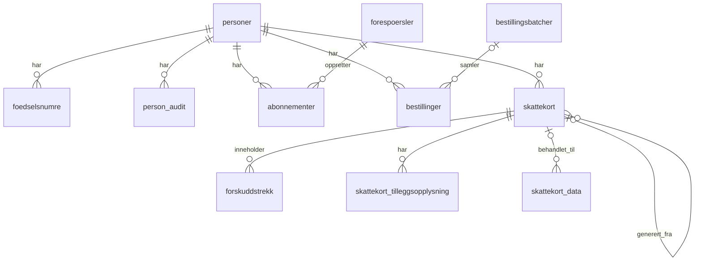

# Datamodell

Applikasjonen bruker PostgreSQL i Cloud SQL med Flyway-migreringer i
[src/main/resources/db/migration](../../src/main/resources/db/migration).
Migreringene samlet, ikke bare opprettelsesskriptene, definerer skjemaet.
Flyway kjøres ved applikasjonsoppstart.

## Tabeller og ansvar

| Tabell | Ansvar |
|--------|--------|
| `personer` | Intern personidentitet og flagg for oppfølging |
| `foedselsnumre` | Identifikatorer koblet til person, med `gjelder_fom` |
| `forespoersler` | Mottatt grunnlag, forsystem og tidspunkt |
| `abonnementer` | Personens interesse for et inntektsår, knyttet til en forespørsel |
| `bestillinger` | Bestillinger per person, identifikator og år; batchreferanse settes etter ekstern bestilling |
| `bestillingsbatcher` | Ekstern bestillingsreferanse, type, status, tidspunkt og sendt innhold; mottatt innhold kan lagres i tillegg |
| `skattekort_data` | Mottatt JSON, identifikator, år og type; `skattekort_id` viser at dataene er behandlet |
| `skattekort` | Versjoner av skattekort, resultat, kilde og eventuell kobling til originalkort |
| `forskuddstrekk` | Trekkode og tabell-, prosent- eller frikortopplysninger |
| `skattekort_tilleggsopplysning` | Tilleggsopplysninger på et skattekort |
| `utsendinger` | Ventende levering med identifikator, forsystem, år, konkret skattekort-ID og feilteller |
| `person_audit` | Personrelatert hendelseshistorikk med tag, informasjon, bruker/system og tidspunkt |
| `scheduled_tasks` | db-scheduler sin kjøretilstand |
| `forespoersel_input` | Historisk importtabell; ingen registrert leser i dagens scheduler |

`bevis_sending` og `scheduled_tasks_history` er fjernet i migreringene.
`skattekort_del` er omdøpt til `forskuddstrekk`.

## Relasjoner

Diagrammet viser sentrale fremmednøkler. Det er en oversikt, ikke en full DDL-definisjon.

`utsendinger.skattekort_id` peker logisk på kortet som skal leveres. Migreringen innfører en sjekk for ikke-null,
men ikke en fremmednøkkel til `skattekort`. `utsendinger` har ikke lenger `abonnement_id`.
Forsystemet for abonnementer finnes via den tilknyttede forespørselen.

## Historikk og behandlingsstatus

Skattekort behandles som versjoner: endringer lagres som nye kort i stedet for å overskrive eksisterende kort.
Kilden skiller mellom mottatte, syntetiserte og manuelle kort.
`generert_fra` kobler et syntetisert kort til originalen.
Et skattekort kan ha resultat og tilleggsopplysninger uten trekkopplysninger.

`skattekort_data` skiller mottak fra konvertering. `bestillingsbatcher` har typene `BESTILLING` og `OPPDATERING`
og statusene `NY`, `RETRY`, `FEILET` og `FERDIG`.
Se [prosesser](../arkitektur/workflows.md) og [resultater](../arkitektur/returer.md) for tolkning.

Bestillinger har unik indeks på person, identifikator og inntektsår.
Utsendinger har unik indeks på identifikator, inntektsår og forsystem; innsetting ved konflikt gjør ingenting.
Dette er lokale duplikatsperrer, ikke en garanti for nøyaktig én ekstern levering.

## Personopplysninger og tilgang

Databasen inneholder identifikatorer, skattekortopplysninger og mottatte og sendte grunnlagsdata.
Begrens oppslag til nødvendig formål og bruk godkjent tilgang.
Ikke kopier rådata til dokumentasjon, ordinære logger, Slack eller åpne saker.
Applikasjonens personhistorikk er ikke det samme som ekstern auditlogging av saksbehandleroppslag.

## Sletting og datalivsløp

Jobben `deleteSkattekort` kaller `SkattekortService.deleteSkattekortForYear()` og sletter som standard skattekort
for inneværende år minus to. Standard kjøreplan er 15. januar. Den tar ikke automatisk alle tidligere år.

Fremmednøkler med `ON DELETE CASCADE` sletter tilhørende forskuddstrekk, tilleggsopplysninger, mottatte data
og avledede kort. Utsendinger har ingen tilsvarende kaskade og må vurderes særskilt ved datarydding.
Jobben er ikke en generell sletterutine for personer, identifikatorer, forespørsler, abonnementer, batcher eller audit.
Oppbevaringskrav og eventuell videre sletting må avklares med fag- og personvernansvarlige.

Ikke bruk `TRUNCATE ... CASCADE` som vanlig feilretting.
Se [historisk nullstilling](../drift/bestillingsfiler.md#historisk-nullstilling-av-database) og
[databasegjenoppretting](../drift/redeploy.md#databasegjenoppretting).

## Endre skjema

Opprett en ny migrering etter [navnekonvensjonen](../../src/main/resources/db/migration/README.md).
Ikke rediger allerede kjørte versjonerte migreringer.
Vurder låser, datamengde, kompatibilitet med gammel og ny kode og påvirkning på produksjonssetting.
Tilbakeføring av et containerimage ruller ikke automatisk tilbake databasen.
