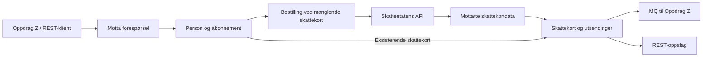

# Systembeskrivelse

## Formål og forretningsverdi

`sokos-skattekort` henter og formidler skattekort som brukes som grunnlag for skattetrekk ved Navs utbetalinger.
Tjenesten erstatter `os-eskatt` sin integrasjon mot Altinn 2 med Skatteetatens API og Maskinporten.
Den samler innhenting, historikk og distribusjon slik at konsumentene ikke trenger egne integrasjoner mot Skatteetaten.

Tjenesten beregner ikke ytelser, utfører ikke utbetalinger og fastsetter ikke den enkeltes skatt.
Skatteetaten leverer skattekortinformasjon; konsumentene bruker informasjonen i sin videre behandling.
Forsinkede eller manglende leveranser kan påvirke grunnlaget for skattetrekk. Den konkrete konsekvensen må
avklares med ansvarlig forsystem, ikke utledes av teknisk status alene.

## Brukere og konsumenter

| Aktør | Behov og bruk |
|-------|--------------|
| Oppdrag Z | Bestiller skattekort og mottar kort og endringer via IBM MQ, med egne leveransekøer for ordinære og store bestillinger |
| Saksbehandlere via REST-klienter | Bestiller og slår opp skattekort, navn og bestillingsstatus innenfor tildelte rettigheter |
| Forvaltning og drift | Undersøker batcher, ventende utsendinger og personhistorikk, og setter feilede batcher til nytt forsøk |
| Testkonsumenter | Bruker kunstige identifikatorer og manuell opprettelse, blant annet via Dolly |
| DARE POC | Har integrasjon for bestilling og mottak i ikke-produksjonsmiljø; utsendingsklienten opprettes ikke i produksjon |

Hvilke klienter som er tillatt i hvert miljø, fremgår av Nais-manifestenes `accessPolicy`.
Det er ikke tilstrekkelig at funksjonaliteten finnes i applikasjonen; klienten må også være tildelt nødvendige scopes eller roller.

## Funksjonelle egenskaper

| Funksjon | Implementert støtte |
|----------|--------------------|
| Motta forespørsler | MQ, enkeltbestilling via REST og bulkbestilling med én identifikator per linje |
| Knytte bestilling til person | Validerer identifikatorer etter miljøprofil og bruker PDL til person- og identifikatorhåndtering |
| Abonnere på skattekort | Lagrer interesse per person og inntektsår, knyttet til forespørsel og forsystem |
| Bestille og hente | Samler bestillinger, lagrer Skatteetatens bestillingsreferanse og henter svar asynkront |
| Motta endringer | Bestiller oppdateringer periodisk og oppretter utsendinger for abonnenter |
| Lagre skattekort | Lagrer mottatte data, trekkopplysninger, kilde og historikk |
| Håndtere særtilfeller | Har regler for ikke-trekkplikt, Svalbard og manglende kildeskatt på pensjon |
| Slå opp og forvalte | Person-API v1/v2, status-API og administrasjons-API |
| Følge opp leveranser | Har personhistorikk, feiltellere, batchstatus og metrikker |

Se [prosessbeskrivelsen](../arkitektur/workflows.md), [resultathåndteringen](../arkitektur/returer.md)
og [grensesnittene](../arkitektur/arkitektur.md) for detaljer.

## Hovedflyt

Flyten er asynkron. Et akseptert bestillingskall er ikke en bekreftelse på at skattekortet er hentet eller levert.
Leveranse til MQ er heller ikke en bekreftelse på ferdig behandling hos Oppdrag Z.

## Forretningsregler og avgrensninger

- Fra 15. desember åpner koden for bestilling av neste års skattekort.
  Ordinære forespørsler for inneværende år kan da også opprette interesse for neste år; `OS_STOR` er unntatt denne utvidelsen.
- Foregående års skattekort kan bestilles til og med juni. Oppdateringsbestillinger gjelder inneværende og,
  når tilgjengelig, neste år. Se [ReglerForInntektsaar](../../src/main/kotlin/no/nav/sokos/skattekort/skattekort/ReglerForInntektsaar.kt).
- MQ-formatet til Oppdrag Z omfatter trekkodene `LOENN_FRA_NAV`, `PENSJON_FRA_NAV` og `UFOERETRYGD_FRA_NAV`.
  Et skattekort uten representerbare trekk kan være lagret uten at en MQ-melding sendes.
- Manuelle skattekort kan opprettes gjennom person-API-et med nødvendige rettigheter.
  Oppslag og manuell opprettelse for reelle identifikatorer krever saksbehandlerkontekst.
- Svalbardsatser er hardkodet for 2025 og 2026 i
  [Syntetisering](../../src/main/kotlin/no/nav/sokos/skattekort/skattekort/Syntetisering.kt).
  Støtte for nye år må avklares og implementeres før årsskiftet; den følger ikke automatisk av at bestilling for året åpnes.
- Bulkbestilling svarer `202 Accepted` før bakgrunnsbehandlingen er fullført. Den har ikke en varig importjobb med
  samlet ferdigstatus. Feil må følges opp i logger og med statusoppslag.
- Den årlige slettejobben sletter skattekort for ett bestemt år. Dette er ikke en fullstendig sletterutine for
  alle personopplysninger. Se [datamodellen](../database/main.md).

## Grunnlag for vurdering av forretningsmessig egnethet

En kommentar om «dårlig forretningsmessig egnethet iht. Gartner-metodikken» er ikke alene en begrunnelse for at hele
applikasjonen er dårlig. En konkret vurdering krever den benyttede vurderingsmodellen, kriteriene, vektingen,
datagrunnlaget og forretningens behov. Disse er ikke dokumentert i repositoryet.
Denne beskrivelsen er derfor et underlag for vurderingen, ikke en Gartner-score eller en godkjent egnethetsvurdering.

Forretningsmessig egnethet og teknisk tilstand må vurderes hver for seg.
At tjenesten har moderne teknologi eller automatiske tester dokumenterer ikke alene at forretningsbehovene er dekket.

| Tema som bør avklares | Underlag i repositoryet | Underlag som må innhentes fra forretning og drift |
|----------------------|------------------------|-------------------------------------------------|
| Støtte til arbeidsprosesser | Bestilling, oppdateringer, oppslag og distribusjon er implementert | Hvilke arbeidsprosesser og brukerbehov som er dekket eller mangler |
| Kvalitet på leveranser | Resultathåndtering, validering, historikk og automatiske tester | Faktiske feil, avvik og konsekvenser for skattetrekk |
| Rettidighet og kapasitet | Kjøreplan, køer og metrikker for ventetid | Godkjente frister, normal- og toppvolum og målt leveringstid |
| Brukervennlighet | API-er for status og forvaltning | Erfaringer fra saksbehandlere, manuell arbeidsmengde og vurdering av klientenes brukerflater |
| Endringsevne | Versjonerte API-er, konfigurasjon og kodebaserte skatteregler | Kommende regelendringer, prioriteringer og evne til å levere innen frist |
| Kontinuitet og forvaltning | Driftsrutiner, eierskap og konfigurasjon for databasegjenoppretting | Avtalte tjenestenivåer, ansvar ved avvik og gjennomførte beredskapsøvelser |
| Kostnad og nytte | Integrasjoner og teknisk driftsoppsett | Forvaltningskostnad, driftskostnad, volum og dokumentert nytte |

Følg opp vurderingen med kriterium, konkret observasjon, konsekvens, kilde, ansvarlig og foreslått tiltak.
Dokumenter også hva som fungerer. Ikke erstatt manglende målinger med antakelser eller en generell karakter.

## Kvalitet og verifikasjon

Eksisterende tester gir etterprøvbare eksempler på funksjonell oppførsel:

| Område | Tester |
|--------|--------|
| Sammenhengende mottak og behandling | [MottaBestillingEndToEndTest](../../src/test/kotlin/no/nav/sokos/skattekort/MottaBestillingEndToEndTest.kt) |
| Forespørsler og abonnementer | [ForespoerselServiceTest](../../src/test/kotlin/no/nav/sokos/skattekort/forespoersel/ForespoerselServiceTest.kt) |
| Bestilling og henting | [BestillingsbatchServiceTest](../../src/test/kotlin/no/nav/sokos/skattekort/skattekortbestilling/BestillingsbatchServiceTest.kt), [BestillingServiceTest](../../src/test/kotlin/no/nav/sokos/skattekort/skattekorthenting/BestillingServiceTest.kt) |
| Årsregler og særtilfeller | [ReglerForInntektsaarTest](../../src/test/kotlin/no/nav/sokos/skattekort/skattekort/ReglerForInntektsaarTest.kt), [SyntetiseringTest](../../src/test/kotlin/no/nav/sokos/skattekort/skattekort/SyntetiseringTest.kt) |
| Utsending og MQ-format | [UtsendingServiceTest](../../src/test/kotlin/no/nav/sokos/skattekort/utsending/UtsendingServiceTest.kt), [SkattekortFixedRecordFormatterTest](../../src/test/kotlin/no/nav/sokos/skattekort/utsending/oppdragz/SkattekortFixedRecordFormatterTest.kt) |
| API-er og rettigheter | [API-tester](../../src/test/kotlin/no/nav/sokos/skattekort/api), [sikkerhetstester](../../src/test/kotlin/no/nav/sokos/skattekort/security) |

Testene erstatter ikke integrasjonskontroll mot IBM MQ, Skatteetaten og andre miljøavhengigheter,
lastmåling eller godkjenning fra forretningen. Se [deploy og gjenoppretting](../drift/redeploy.md).

## Eierskap og dokumentasjonsansvar

Kodeeier er [@navikt/okonomi](../../CODEOWNERS). Interne henvendelser går til
[#utbetaling](https://nav-it.slack.com/archives/CKZADNFBP).
Utviklerteamet vedlikeholder tekniske beskrivelser og driftsrutiner.
Forretningsansvarlig må bekrefte behovsdekning, frister, konsekvenser og eventuelle egnethetsvurderinger.
